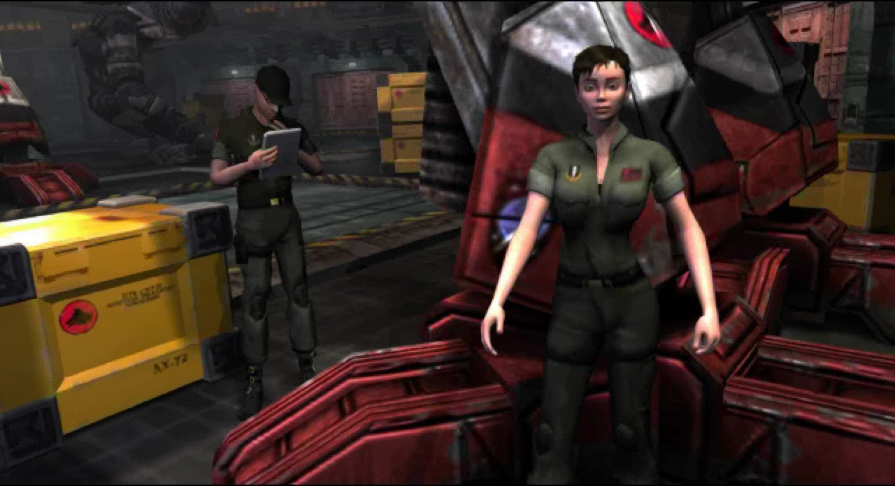
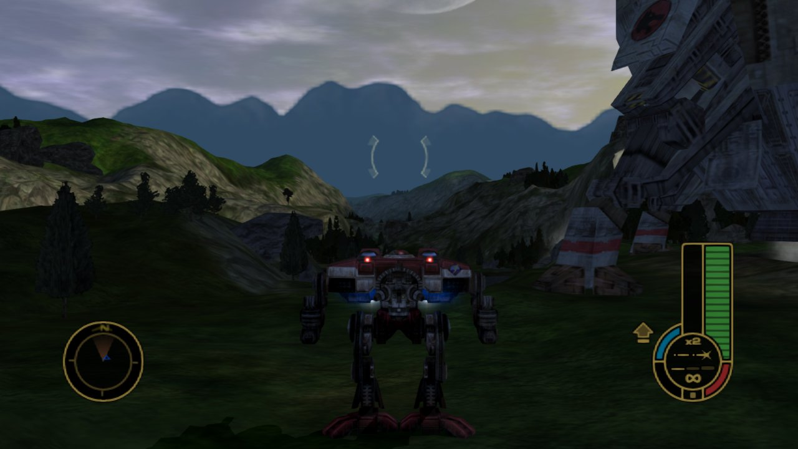
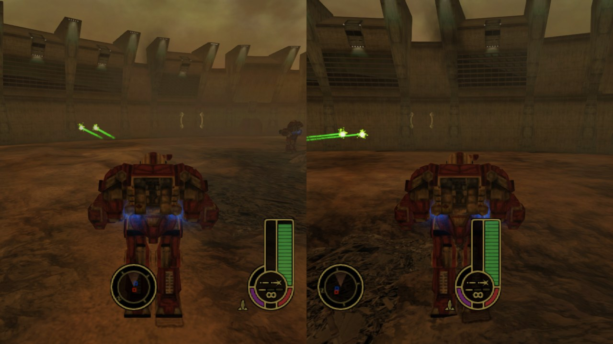
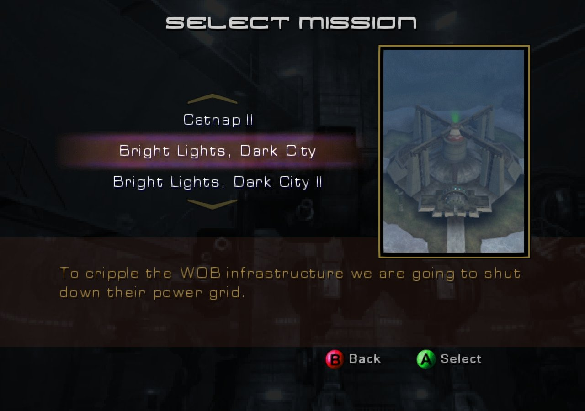
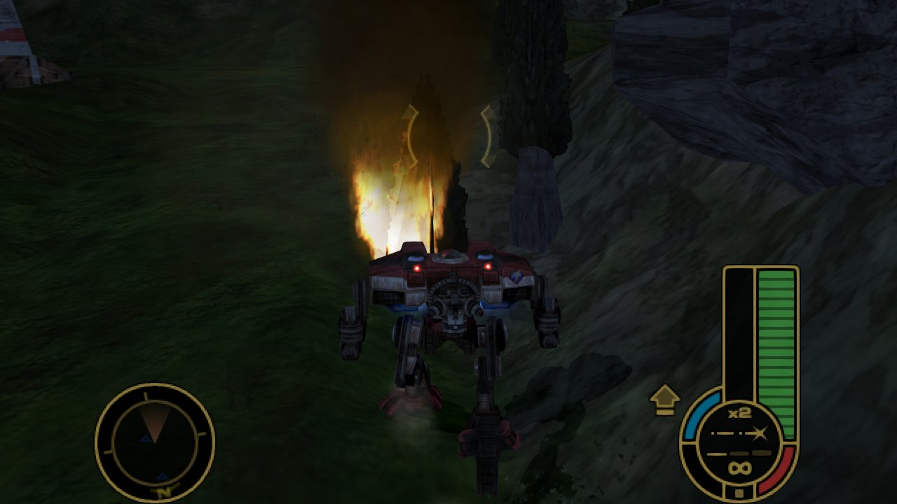

# MechAssault Xbox PC Recomp

A native Windows PC port of **MechAssault**, Day 1 Studios' 2002 'Mech combat game for the original Xbox.

**Play in widescreen at 60 FPS, with keyboard and mouse controls, split-screen and System Link multiplayer. No emulator required.**

**Free and open-source.**

Like the recomp and want to support future projects? You can
tip me on [Ko-fi](https://ko-fi.com/caiuscodes).

> **You must provide your own copy of MechAssault for the original Xbox.** No original game files, code or assets are distributed with this project. The setup imports everything it needs from your own copy the first time you play.

## Download & Installation

**[Download the latest release](https://github.com/CaiusCodes/MechAssault-Xbox-PC-Recomp/releases)**

1. Download the latest ZIP and extract the **MechAssault** folder anywhere you can save files (not Program Files).
2. Run `MechAssault.exe`.
3. Pick your copy of the game with **Disc image...** or **Folder...**, or drop it on the setup window.
4. Choose your options: fullscreen, a desktop shortcut, unlocking the whole campaign, the game's language and where to keep your saves.
5. Click **Play**. The first start takes about a minute to prepare the game, and only happens once.

After setup, simply run `MechAssault.exe` to play. Your disc image is no longer needed.

**To reopen setup:** Start `MechAssault.exe --setup`, or delete the `resources\game` folder.

The installation is portable, with the game, saves and settings kept inside the MechAssault folder, but you can keep your saves in another folder (another drive or a synced folder) by choosing **Game save location** in setup.

### System Requirements

- Windows 10 or 11 (64-bit)
- A DirectX 12 graphics card (integrated graphics work)
- Your own copy of MechAssault for the original Xbox

The setup accepts **MechAssault (USA) Rev 1**, the 2003 reissue most copies are, including copies patched to be region-free or run from a hard drive.

## Features

### Graphics & Performance

- **60 FPS** by default, twice the original. The game keeps its normal speed. Higher limits (120 and 144 FPS) also work but are less tested.
- **Widescreen:** 16:9 shows more of the battlefield at the sides, with nothing stretched. The radar and weapon gauges move out to the screen's edges. 21:9 ultrawide also works but is less tested.
- **Sharper picture:** Render the game at up to 4 times the Xbox's resolution, or let Auto pick for your screen.
- **Smoother edges:** SMAA or FXAA anti-aliasing, texture filtering, sharpening and AMD FSR upscaling.
- Adjustable **draw distance**, **field of view** and brightness.
- Every setting applies instantly from the **F1** menu, with no restart.

### Controls & Quality of Life

- Full **keyboard and mouse** support: the mouse turns your 'Mech and aims, with rebindable keys and adjustable sensitivity.
- **Mouse in the menus:** point and click, right click to go back. With no controller plugged in, the on-screen button prompts show your keys instead.
- **Xbox controllers** and other gamepads work just like on the console.
- **Settings menu** on **F1** (or hold Back and press Start on a controller), with Display, Graphics, Game, Controls and Network pages.
- **FPS counter** on **F2**.
- Play in **English, French or German**, text and speech.
- Built-in update checker.
- Portable installation, with saves where you choose.

### Multiplayer

- **Split-screen** for two players on one PC.
- **System Link** over your home network.
- Online play through a virtual LAN (Radmin VPN, ZeroTier, Hamachi or Tailscale) or the host's internet address also works but is less tested.

#### Playing over LAN or a virtual LAN

1. Every player needs the same version of this port and a Rev 1 copy of the game.
2. On a virtual LAN, join the same network and pick it under **F1 → Network**.
3. The host picks **Multiplayer → System Link**, chooses a profile and creates a game. Everyone else finds it in the games list.

To join by address instead, enter the host's address under **F1 → Network → Join address**. The host has to forward UDP ports 1000 to 1002. Windows Firewall may ask for permission the first time you host or join.

### Extras & Cheats

- **Unlock the whole campaign:** Every mission and movie becomes playable from **Select Mission**. Turn it on in setup or under **F1 → Game**.

## Keyboard & Mouse Controls

| Key | Action |
|---|---|
| W, A, S, D | Move |
| Mouse (or I, J, K, L) | Turn and aim |
| Left Click or Enter | Fire |
| Right Click, Q or Mouse Wheel | Cycle weapons |
| 1, 2, 3 | Energy, ballistic, missile weapon |
| Space (hold) | Jump jets |
| Left Shift or F | Defense |
| Tab | Scoreboard |
| T | Team chat |
| Esc | Pause |
| M | Start menu |
| Enter / Backspace | Menu select / back |
| Arrow Keys | D-pad |
| F1 | Settings |
| F2 | FPS counter |
| F8 | Mark a bug |

Keys can be customised under **F1 → Controls**.

Controllers use the original console controls, so you can plug one in and play.

## Updates

Check for new versions through **F1 → Check for updates**.

Updates are downloaded and installed without affecting your imported game, saves or settings.

Alternatively, download the latest release ZIP and extract it over your existing installation.

## Known Limitations

- Windows only.
- Only MechAssault (USA) Rev 1 is accepted for now; the original 2002 disc isn't supported yet. If setup refuses your copy, it saves `MechAssault-copy-check.txt` on your Desktop saying which version you have.
- Rev 1 and the 2002 disc can't play System Link together, so everyone needs Rev 1.
- Xbox Live and downloadable content are not supported.
- Not every campaign mission has been played through on this version yet.
- Windows SmartScreen or your antivirus may warn about the unsigned executable; see `ANTIVIRUS.txt` in the game folder.
- Windows Firewall may ask for permission for multiplayer.

## Reporting Issues

If something goes wrong while you play, press **F8** to mark the moment: it saves a picture and a note for the report.

1. Close the game.
2. Make a problem report: after a crash, the game offers to save one to your Desktop. Otherwise, start `MechAssault.exe --save-report`.
3. [Open a GitHub Issue](https://github.com/CaiusCodes/MechAssault-Xbox-PC-Recomp/issues) and attach the report's ZIP file.

Nothing is ever sent automatically.

## Building from Source

You need Visual Studio 2022 or later with the C++ workload (including clang), CMake, Ninja and your own Rev 1 copy of the game, extracted into the `game_files` folder. Build with the commands in [docs/REV1.md](docs/REV1.md), then run `release.bat rev1` to make the portable package, which contains no game code. More notes are in the [docs](docs) folder.

## Development & Credits

This project builds upon the work of:

- [XboxXBE-Recomp](https://github.com/TGP482/XboxXBE-Recomp) by TGP482 – Original Xbox static recompilation toolkit.
- The Breakdown Xbox PC port – Shared setup, graphics, input and updater work.
- [SMAA](https://github.com/iryoku/smaa) by Jorge Jimenez et al. – Anti-aliasing.
- AMD FidelityFX Super Resolution 1 – Upscaling.
- [Dear ImGui](https://github.com/ocornut/imgui) and [SDL](https://github.com/libsdl-org/SDL) – Settings menu and controller support.

The project's own game-port code is released under [The Unlicense](LICENSE), and the SDK and third-party dependencies retain their respective licences (see [sdk/LICENSE](sdk/LICENSE) and [sdk/THIRD_PARTY.txt](sdk/THIRD_PARTY.txt)).

---

*MechAssault, BattleTech, Xbox and Microsoft are trademarks or property of their respective owners. This is an independent fan project and is not affiliated with or endorsed by the rights holders.*
