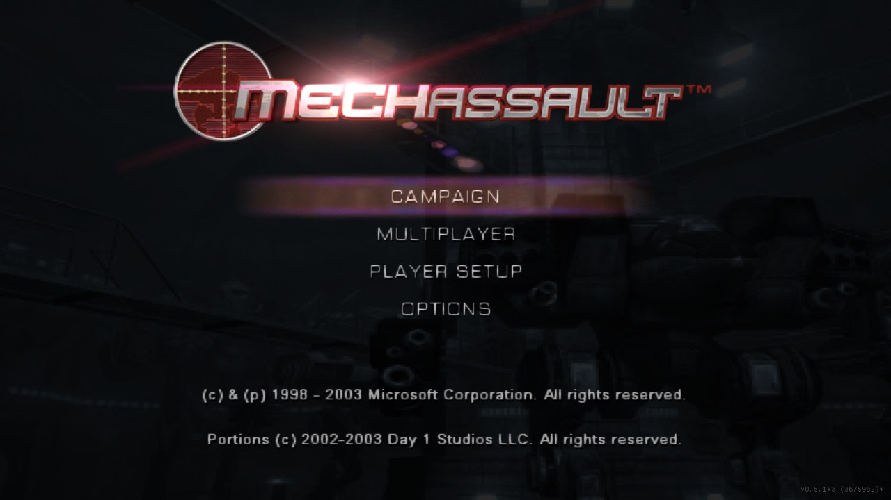
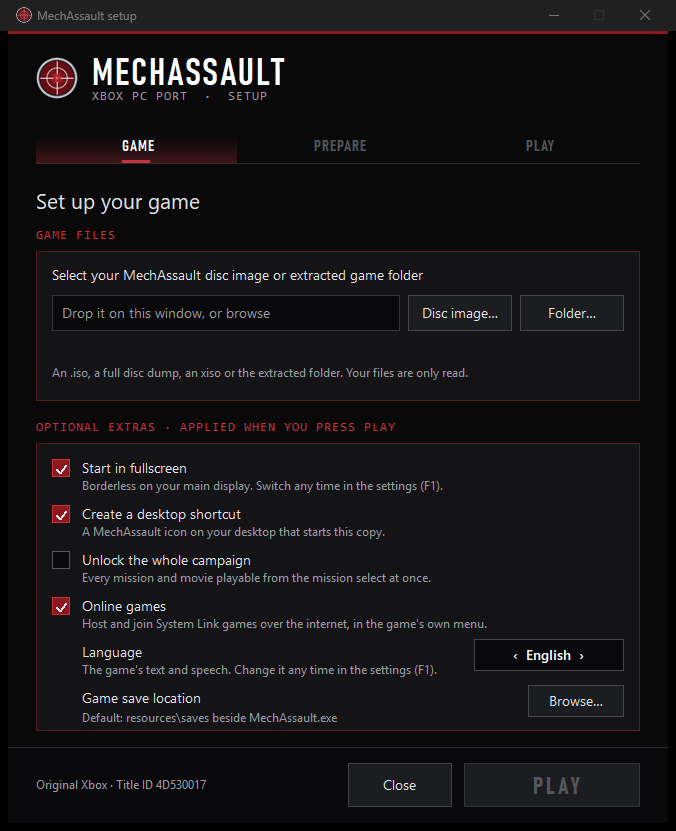
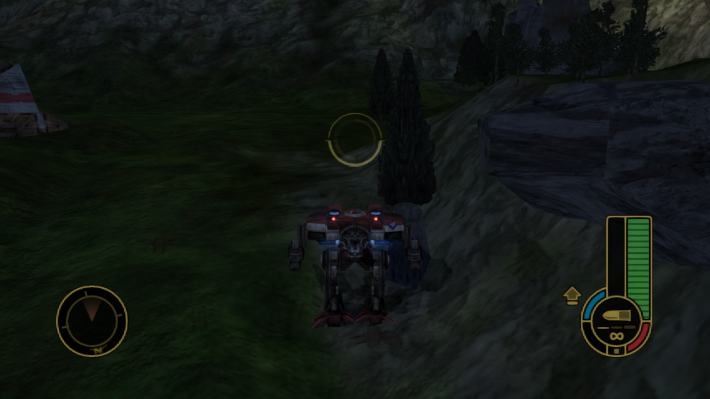

# MechAssault Xbox PC Recomp

A native Windows PC port of **MechAssault** (Day 1 Studios / Microsoft, original Xbox, 2002), built by static
recompilation with [XboxXBE-Recomp](https://github.com/TGP482/XboxXBE-Recomp).

Play at **up to 4K and 60 or 120 FPS**, in true 16:9 and 21:9 widescreen, with keyboard and mouse look, split-screen
and System Link multiplayer over LAN or a virtual LAN. No emulator required.

**Free and open-source.**

Like the recomp and want to support future projects? You can
tip me on [Ko-fi](https://ko-fi.com/caiuscodes).

[](https://ko-fi.com/caiuscodes)



> **You must provide your own copy of MechAssault.** No original game files or assets are distributed with this
> project. The setup imports the required files from your disc image or extracted game folder, and builds the game
> code for your PC from your own copy on the first start.

## Download & Installation

**[Download the latest release](https://github.com/CaiusCodes/MechAssault-Xbox-PC-Recomp/releases)**

1. Download the latest ZIP and extract the **MechAssault** folder anywhere you can write to (not Program Files).
2. Run `MechAssault.exe`.
3. Select your MechAssault disc image (`.iso`, a full disc dump or an xiso) or extracted game folder using
   **Disc image...** or **Folder...**, or drop it on the setup window.
4. Choose your options: fullscreen, desktop shortcut, unlocking the whole campaign, online games, the game's language,
   and optionally another folder for your saves.
5. Click **Play**. The first start copies the game and builds its code for your PC (about a minute, once).



After setup, simply run `MechAssault.exe` to play. Your disc image is no longer needed.

**To run setup again:** start `MechAssault.exe --setup`, or delete `resources\game`.

The installation is portable: the imported game, saves and settings stay inside the MechAssault folder. Saves can be
kept in another folder instead (another drive or a synced folder): choose it under **Game save location** in setup.

### Supported release

**MechAssault (USA) Rev 1**, the 2003 reissue most copies are (`default.xbe` built 2003-08-08, certificate version 8,
title ID `4D530017`). Copies patched by a mod pack or dump tool (region-free, HDD-ready, re-signed) are accepted as
long as the game code is unchanged. The original 2002 disc (MechAssault (USA, Europe)) is not supported by this
release, and System Link only works between copies of the same release.

Not sure which one you have? Run **Check my MechAssault copy.bat** in the release folder and choose your
`default.xbe` or disc image: it writes `MechAssault-copy-check.txt` on your Desktop.

### System Requirements

- Windows 10 or 11 (64-bit)
- A DirectX 12 graphics card (integrated graphics work)
- Your own MechAssault disc image or extracted game files (Rev 1)

## Features

### Graphics & Performance

- **Native PC rendering** with DirectX 12
- **60 FPS** by default, or 120 FPS or your monitor's rate; the game times everything itself, so its speed is unchanged
- **True widescreen:** 16:9, 21:9 and wider show more at the sides; the radar and weapon gauges move out to the
  screen's edges, menus and movies stay 4:3
- **Render scale** 1x (the Xbox's 640x480) to 4x, or Auto
- **FSR 1** upscaling, **SMAA** or FXAA anti-aliasing, anisotropic filtering, sharpening
- Adjustable field of view
- Every setting applies at once from the **F1** menu



### Controls & Quality of Life

- Full **keyboard and mouse** support: mouse look turns your 'Mech and aims, rebindable keys, adjustable sensitivity
- **Xbox controllers** and other gamepads
- PC button prompts in the menus when no controller is connected, clickable with the mouse
- Optional **unlock of the whole campaign**: every mission and movie from the mission select
- Built-in update checker
- Portable installation, with saves where you choose
- **Make a problem report.bat** saves the logs and crash reports in a zip to send

### Multiplayer

- **Split-screen** for two players on one PC
- **System Link** on a LAN, and over the internet through a virtual LAN (Radmin VPN, ZeroTier, Hamachi, Tailscale)
  or a direct address

#### Playing over LAN or a virtual LAN

1. Every player runs the same version with the same release of the game (Rev 1).
2. On a virtual LAN, join the same network and pick its adapter in **F1 > Network**.
3. The host picks **Multiplayer > System Link**, a profile, then creates a game; the others find it in the Games List.

To join by address instead, enter the host's public address in **F1 > Network > Join address**; the host forwards
UDP ports 1000-1002. Windows Firewall may ask to allow MechAssault the first time a game is hosted or joined. Xbox
Live is gone and stays greyed out.


## Keyboard & Mouse Controls

| Key | Action |
|---|---|
| W, A, S, D | Move |
| Mouse | Turn and aim |
| Left Click | Fire |
| Right Click, Q or Mouse Wheel | Cycle weapons |
| 1, 2, 3 | Energy, ballistic, missile weapons |
| Space | Jump jets |
| Shift or F | Defense |
| Esc | Pause |
| Enter / Backspace | Menu select / back |
| F1 | Settings |

Keys can be changed under **F1 > Controls**.

## Updates

Check for new versions through **F1 > Check for updates**. Updates are downloaded and installed without touching your
imported game, saves or settings. Alternatively, download the latest release ZIP and extract it over your existing
installation.

## Known Limitations

- Windows only.
- Only MechAssault (USA) Rev 1 is accepted; the original 2002 release is not (yet).
- Xbox Live and downloadable content are not supported.
- Windows SmartScreen or antivirus programs may warn about the unsigned executable; see `ANTIVIRUS.txt` in the
  release folder.
- Windows Firewall may ask for permission for multiplayer.

## Reporting Issues

Found a bug? [Open a GitHub Issue](https://github.com/CaiusCodes/MechAssault-Xbox-PC-Recomp/issues) and attach the zip
that **Make a problem report.bat** saves on your Desktop, or your latest log from:

`resources\logs\mechassault.log`

## Building from source

Visual Studio 2022 or later with the C++ workload, LLVM clang, CMake and Ninja. Extract your Rev 1 game to
`game_files\MechAssault (USA) (En,Fr,De) (Rev 1)\` (git-ignored), then:

```
scripts\b.bat cmake --preset release -B out/build/rev1 "-DXBE_ASSETS_DIR=%CD%/game_files/MechAssault (USA) (En,Fr,De) (Rev 1)" -DXBE_GENERATED_DIR=%CD%/generated-rev1
scripts\b.bat cmake --build out/build/rev1 -j 6
release.bat rev1
```

`out\build\rev1` needs an `assets` junction to the same game folder to run from there. `release.bat rev1` makes the
portable package, which holds no game code: the player's PC builds it from their own copy on the first start. Each
GitHub release attaches that package as `MechAssault.zip`, which the updater looks for.

More in `docs/`: `REV1.md` (the supported release and how the port moved to it), `PORTING_PROGRESS.md`,
`MECHASSAULT_TECHNICAL_ANALYSIS.md`, `GRAPHICS_AND_PERFORMANCE.md`, `KNOWN_ISSUES.md` and `testing.md`.

## Development & Credits

This project builds upon the work of:

- [XboxXBE-Recomp](https://github.com/TGP482/XboxXBE-Recomp) by TGP482 – Original Xbox static recompilation
  toolkit (vendored in `sdk/`).
- The Breakdown Xbox PC port – Shared runtime work (setup, renderer, input, updater).
- [SMAA](https://github.com/iryoku/smaa) by Jorge Jimenez et al. – Anti-aliasing.
- AMD FidelityFX Super Resolution 1 – The upscaling algorithm, reimplemented.

The project's own game-port code is released under [The Unlicense](LICENSE). The SDK and third-party dependencies
retain their respective licences (`sdk/LICENSE`, `sdk/THIRD_PARTY.txt`).

---

*MechAssault, BattleTech, Xbox and Microsoft are trademarks or property of their respective owners. This is an
independent fan project and is not affiliated with or endorsed by the rights holders.*
